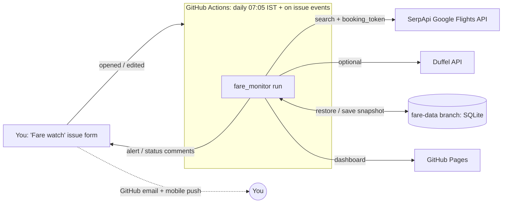

# Architecture and implementation plan

## Goal

Track the cheapest **one-way, economy, 1-adult** fares for routes and dates you choose (first watch:
**Jaipur (JAI) → Kochi (COK)**, 4 and 5 January 2027), on a schedule you set per watch. Alert only on
fares that a seller or booking system actually confirmed, and only when something meaningfully changes.

## Components

| Concern | Choice | Why |
|---|---|---|
| What to watch | GitHub issue form: route, dates or range, frequency or weekdays, book-now price, stops | A real form that works on a phone. No hosting, and no API key exposed in a public web page |
| Scheduler | One GitHub Actions cron a day; each watch decides if today is a check day. Issue events trigger an immediate check | Free and managed. Research shows no reliable time-of-day pricing pattern, so one fixed time is enough |
| Storage | SQLite on an orphan `fare-data` branch (one force-pushed snapshot), plus a 14-day artifact backup | No server to run; the full history lives in the database |
| Notifications | Comments on the watch issue: GitHub emails the author and notifies the mobile app. Email (SMTP) and Telegram are optional | No extra accounts or secrets |
| Budget | 1 search per route/date per check, shared across watches. Seller confirmation only when it could trigger an alert. SerpApi's own account API is read before each run, and checks pause with 20 searches left | Stays inside the 250-search free plan |
| Dashboard | Static `index.html` published to GitHub Pages; status comment on each watch | Viewable anywhere |

## Fare sources

There is no HTML scraping. Each source is an official or commercial API used under its own terms.

| Source | What it gives | Status recorded |
|---|---|---|
| **Duffel** (`api.duffel.com`, live token) | Real airline offers (NDC/GDS). The cheapest `verify_top_n` per date are re-fetched with `GET /air/offers/{id}`, so the price reflects the latest airline pricing and the offer hasn't expired | `VERIFIED` after re-pricing, `INDICATIVE` before |
| **Google Flights via SerpApi** | Google Flights search results (which include airline sites and Indian OTAs such as MakeMyTrip, Cleartrip and ixigo as sellers). For the cheapest `booking_checks_per_date` itineraries, the `booking_token` call returns what each named seller charges. The airline's own quote is preferred over OTA quotes | `SELLER_QUOTED` after the booking-options call, `INDICATIVE` before |

Sources the brief listed but which this monitor does not query directly:

* **Skyscanner**: the API is partner-only (requires a commercial agreement). It can be added as a
  provider once access is granted (`fare_monitor/providers/` has a two-method interface).
* **MakeMyTrip, Cleartrip, ixigo**: no public fare APIs. Their terms forbid automated scraping. Their
  prices still reach the monitor as sellers in Google Flights booking options.
* **Airline websites (IndiGo, Air India, Air India Express, Akasa, SpiceJet)**: no public shopping APIs.
  Airline-direct prices come through Duffel (where the airline is distributed) and as the airline seller
  in Google booking options.
* **Amadeus Self-Service**: shut down on 17 July 2026. Only the Enterprise API, which requires a contract,
  remains.

## Verification levels and the "don't trust the advertised fare" rule

1. `INDICATIVE` is a search-result price. It is stored and shown, but **it never sets a record low and
   never alerts** under the default `alert_min_status = "seller_quoted"`.
2. `SELLER_QUOTED`: Google Flights shows the final price a named seller (e.g. IndiGo) quotes for this
   exact itinerary, taxes included, at the stored timestamp. OTA quotes are labelled because OTAs can add
   convenience or payment fees at checkout.
3. `VERIFIED` is a live Duffel offer re-priced moments ago. It is bookable as-is until `expires_at`.

Every stored price also passes these checks:
* currency must be INR (prices are never converted)
* route and departure date must match the request
* fare must be between ₹1,000 and ₹1,50,000, so parsing errors are rejected rather than reported
* the offer must not have expired
* the preference filters apply: max stops, max duration, departure window, minimum and maximum layover

Duffel test-mode tokens are refused: their airlines are synthetic. Failed searches store no prices.
Prices older than 8 days are marked **stale** on the dashboard.

## Check cycle (`fare_monitor/runner.py`)

1. **Load watches.**
   * Read open issues titled `[Fare watch]` (or labelled `fare-watch`) from the owner or collaborators.
   * An invalid watch gets one comment explaining the problem.
   * A closed issue stops its watch.
   * When the dates have passed, a final summary is posted and the issue is closed.
2. **Decide what's due.** A watch is checked if it's new or edited, or if today is one of its check days
   and it hasn't been checked today.
3. **Check the budget.**
   * Get usage from SerpApi's account API, which is free and doesn't count as a search, or from the
     monitor's own counter.
   * If there isn't enough left, the soonest travel dates are searched first. When nothing is left, every
     watch gets one "paused" comment per month.
4. **Search** each route/date once. Then validate the results: INR only, correct route and date,
   plausible price, preference filters.
5. **Confirm** (one extra search) the cheapest option only when:
   * it's the first price for that date,
   * its search price is below the search price behind the lowest confirmed fare, or
   * it's at or below a watch's book-now price and wasn't confirmed in the last 72 hours.
6. **Store** the top options, the best-value option and anything confirmed, each with its source and
   timestamp.
7. **Alert per watch**, using only confirmed prices: under book-now price, new record low (at least ₹200
   and 2%), or a new or returning flight within 5% of the lowest. Each condition has a deduplication key,
   so an unchanged price never alerts twice. All of a watch's alerts from one check go in one comment, so
   one email.
8. **Status:** edit the watch's status comment (no email), write the dashboard, and save the database.

## Database schema (SQLite)

`runs`, `searches` (per provider and date: status, error, counts, Google price insights),
`observations` (every stored fare with all captured fields), `record_lows`, `alerts` (with deduplication
key and channels) and `kv` (daily-summary and health state). See `fare_monitor/db.py`.

## Running elsewhere (optional)

* **AWS**: package the same code as a Lambda function on an EventBridge `rate(1 hour)` rule. Keep
  `fares.sqlite3` in S3 (download at start, upload at end) or point it at RDS PostgreSQL. Put secrets in
  Secrets Manager and logs in CloudWatch, with an alarm on errors.
* **Any VM or cron**: `17 * * * * cd /opt/fare-monitor && python -m fare_monitor run`.
