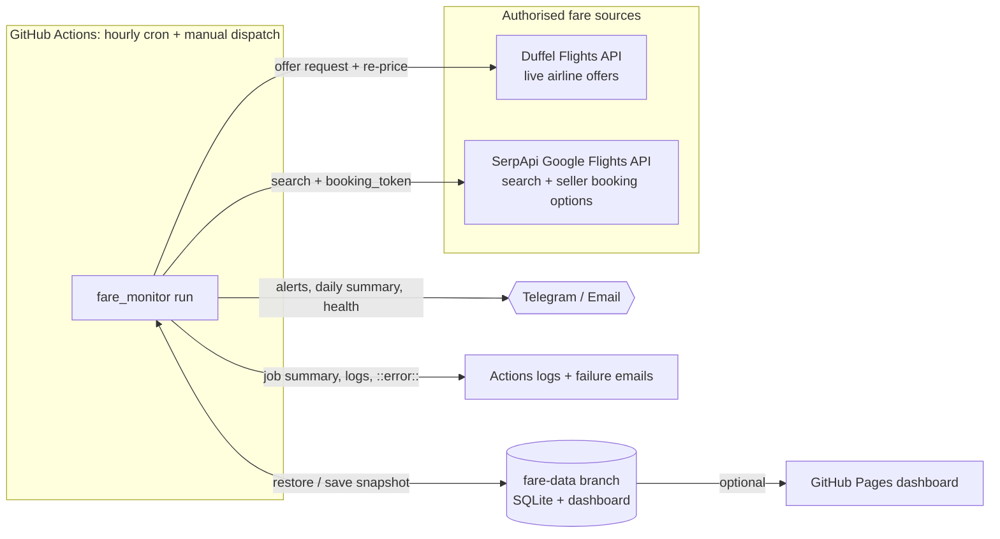

# Architecture and implementation plan

## Goal

Track the cheapest **one-way, economy, 1-adult** fare from **Jaipur (JAI)** to **Kochi (COK)** on
**4 January 2027** and **5 January 2027**, every hour, until the dates pass or you stop it. Alert only on
fares that a seller or booking system actually confirmed, and only when something meaningfully changes.

## Components

| Concern | Choice | Why |
|---|---|---|
| Language | Python 3.12, `requests` only | Small, auditable, easy to run anywhere |
| Scheduler | GitHub Actions `cron: "17 * * * *"` | Free, managed, has secrets, logs and failure emails. Runs at :17 to avoid the top-of-hour backlog |
| Storage | SQLite file kept on an orphan `fare-data` branch | No server to run. Every observation, search and alert is a row. The branch is force-pushed as one snapshot so the repo doesn't grow by a database copy per hour. Each run's database is also kept as a 14-day artifact |
| Notifications | Telegram Bot API and/or SMTP email, chosen with `NOTIFY_CHANNELS` | Telegram is instant on a phone; email is a fallback |
| Dashboard | Static `index.html` (no external libraries) on the `fare-data` branch; Markdown job summary on every run | Viewable from GitHub, Pages, or a downloaded file |
| Monitoring | Run status per search, `::error::` annotations, failed job → GitHub email, operations alert after 3 fully failed runs, recovery notice | You hear about outages, not only about fares |

## Fare sources

There is no HTML scraping. Each source is an official or commercial API used under its own terms.

| Source | What it gives | Status recorded |
|---|---|---|
| **Duffel** (`api.duffel.com`, live token) | Real airline offers (NDC/GDS). The cheapest `verify_top_n` per date are re-fetched with `GET /air/offers/{id}`, so the price reflects the latest airline pricing and the offer hasn't expired | `VERIFIED` after re-pricing, `INDICATIVE` before |
| **Google Flights via SerpApi** | Google Flights search results (which include airline sites and Indian OTAs such as MakeMyTrip, Cleartrip and ixigo as sellers). For the cheapest `booking_checks_per_date` itineraries, the `booking_token` call returns what each named seller charges. The airline's own quote is preferred over OTA quotes | `SELLER_QUOTED` after the booking-options call, `INDICATIVE` before |

Sources the brief listed but which this monitor does not query directly:

* **Skyscanner**: the API is partner-only (requires a commercial agreement). It can be added as a
  provider once access is granted (`fare_monitor/providers/` has a two-method interface).
* **MakeMyTrip, Cleartrip, ixigo**: no public fare APIs. Their terms forbid automated scraping. Their
  prices still reach the monitor as sellers in Google Flights booking options.
* **Airline websites (IndiGo, Air India, Air India Express, Akasa, SpiceJet)**: no public shopping APIs.
  Airline-direct prices come through Duffel (where the airline is distributed) and as the airline seller
  in Google booking options.
* **Amadeus Self-Service**: shut down on 17 July 2026. Only the Enterprise API, which requires a contract,
  remains.

## Verification levels and the "don't trust the advertised fare" rule

1. `INDICATIVE` is a search-result price. It is stored and shown, but **it never sets a record low and
   never alerts** under the default `alert_min_status = "seller_quoted"`.
2. `SELLER_QUOTED`: Google Flights shows the final price a named seller (e.g. IndiGo) quotes for this
   exact itinerary, taxes included, at the stored timestamp. OTA quotes are labelled because OTAs can add
   convenience or payment fees at checkout.
3. `VERIFIED` is a live Duffel offer re-priced moments ago. It is bookable as-is until `expires_at`.

Every stored price also passes these checks:
* currency must be INR (prices are never converted)
* route and departure date must match the request
* fare must be between ₹1,000 and ₹1,50,000, so parsing errors are rejected rather than reported
* the offer must not have expired
* the preference filters apply: max stops, max duration, departure window, minimum and maximum layover

Duffel test-mode tokens are refused: their airlines are synthetic. Failed searches store no prices.
Data older than 120 minutes is marked **stale** and is never shown as current.

## Hourly cycle (`fare_monitor/runner.py`)

1. Skip if `MONITOR_ENABLED=false`. If both dates have passed, send one final summary, then the workflow
   disables itself.
2. For each remaining date, independently, and each configured provider:
   1. search
   2. validate and filter
   3. verify the cheapest options
   4. validate again
   5. store the top 20 plus the best-value option, each with its source and timestamp

   A provider error is recorded and the run continues with the other providers.
3. Decide alerts (`fare_monitor/analysis.py`) using only fares at or above `alert_min_status`:
   * **Baseline**: the first eligible fare per date (one message, can be disabled).
   * **Record low**: lower than every earlier eligible fare for that date, by at least ₹200 **and** 2%.
     Smaller dips are still recorded in `record_lows`, but no alert is sent.
   * **Attractive fare**: at or below `TARGET_FARE_INR` (if set), or at least 15% below the 7-day median
     of hourly lows (needs 24 or more hourly lows first, so no guessing on thin data).
   * **Previously unavailable flight now bookable**: a flight key (date + flight numbers) never seen
     before, or unseen for 6 hours or more, that now sells within 5% of the date's current lowest fare.
   * Every alert has a deduplication key (type + flight + price), so an unchanged price never alerts
     twice. If no channel accepts a message it is not marked as sent, so a still-valid
     target, attractive or new-flight alert fires again next hour.
4. Send the daily summary once per day after 08:00 IST.
5. Write `index.html`, `summary.md` and `summary.json`, and append the Markdown to the Actions job summary.

## Database schema (SQLite)

`runs`, `searches` (per provider and date: status, error, counts, Google price insights),
`observations` (every stored fare with all captured fields), `record_lows`, `alerts` (with deduplication
key and channels) and `kv` (daily-summary and health state). See `fare_monitor/db.py`.

## Running elsewhere (optional)

* **AWS**: package the same code as a Lambda function on an EventBridge `rate(1 hour)` rule. Keep
  `fares.sqlite3` in S3 (download at start, upload at end) or point it at RDS PostgreSQL. Put secrets in
  Secrets Manager and logs in CloudWatch, with an alarm on errors.
* **Any VM or cron**: `17 * * * * cd /opt/fare-monitor && python -m fare_monitor run`.
